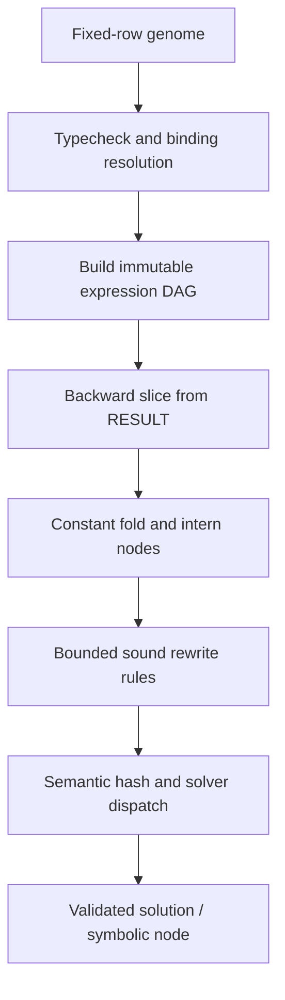
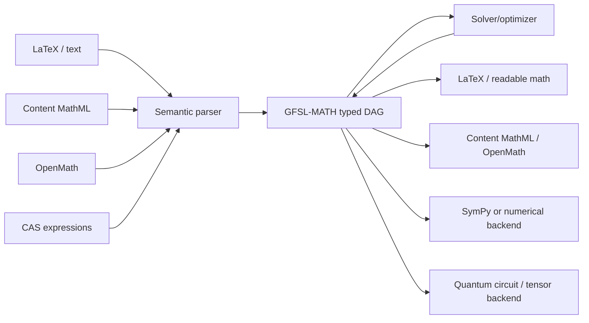

# GFSL-MATH — Fixed-Structure Mathematical Expression, Equation and Solver Extension

**Status:** Proposed companion specification, draft 0.1  
**Date:** 5 November 2026  
**Parent specification:** *Genetic Fixed Structure Language — Specifications*, draft 3 (5 September 2025), Riccardo Cecchini.  
**Purpose:** Define a small, fixed-row semantic intermediate representation capable of expressing mathematical objects and constraints, transforming them between notations and computational backends, and dispatching their solution to appropriate exact, symbolic, numerical, or quantum algorithms.

> **Design claim (carefully scoped).** GFSL-MATH is intended to represent a broad and extensible class of mathematical expressions, equations, systems, and operators. It does **not** imply that every well-formed mathematical statement has a decidable solution, a closed form, or an efficient general solver. Representability, decidability, and computational tractability are separate properties.

## Executive design decision

Keep the genetic instruction as a **fixed-size row**. Express advanced mathematical structures as typed references to earlier rows, rather than embedding variable-length syntax in a row. Use a minimal set of semantic constructors and a modular operation registry. Optional high-level operations are lowered into the core representation where possible, or dispatched to specialized solvers when necessary.

The parent draft simultaneously refers to *six slots* and explicitly lists *ten numeric slots*. The following compatibility convention resolves this **without claiming that they are the same physical layout**:

- **Logical row:** ten scalar fields, with target and each of two operands as three-field pointers.
- **Packed row:** six fixed-width machine words by packing both source pointers into one word each. This is an optional serialization, **not** a six-field logical model.
- **No variable-length row**, even for n-ary functions, integrals, tensor indices, or quantum circuits.

---

# 1. Normative scope and invariants

The words **MUST**, **SHOULD**, and **MAY** express proposed conformance requirements for this extension, not claims about the existing draft.

## 1.1 Principles retained from GFSL

1. **Fixed row shape.** A genome is an ordered series of instructions of identical structure.
2. **Cascading validity.** Legal choices at each field depend on the preceding fields and the current resource/type environment.
3. **Typed resource indices.** No source-level variable names are required; friendly mathematical names are metadata only.
4. **Progressive activation.** Only types and operations useful to the problem domain enter the active evolutionary search space.
5. **Short effective genome.** Backward dependency analysis from result objects removes irrelevant instructions.
6. **Local mutations and block-aware crossover.** Revalidation or deterministic repair is permitted after a mutation.
7. **Separate value-selection modes.** Enumerated constants are distinct from arbitrary numeric/learned payloads.

The parent document's stated aspiration that every mutation is valid needs a precise boundary: **selecting a valid option at one slot does not automatically make every downstream reference and domain condition valid**. Conformance requires repair, masking, or rejection of affected choices. A mathematically undefined expression (e.g. division by zero) is representable but cannot be silently treated as a successful evaluation.

## 1.2 Three different layers

| Layer | Responsibility | Examples |
|---|---|---|
| **Genome/wire layer** | Fixed row shape, identifiers, references, mutations | `[$,r,2,ADD,$,r,0,$,r,1]` |
| **Semantic math layer** | Typed expression DAG, binders, domains, assumptions, exactness, operator meaning | `x^2 + 1`, `∂f/∂x`, `⟨ψ|H|ψ⟩` |
| **Execution/solver layer** | Simplification, algebraic/numeric solving, quadrature, differentiation, quantum simulation | polynomial factorization, sparse solve, ODE integration |

These layers MUST NOT be conflated: a solver instruction names a *request* and produces a typed result object; it does not magically make the underlying mathematical problem solvable.

---

# 2. Instruction encoding and pointer model

## 2.1 The canonical ten-field row

```text
[ T_CAT | T_TYPE | T_ID | OP | A_CAT | A_TYPE | A_ID | B_CAT | B_TYPE | B_ID ]
   0       1       2     3      4       5       6       7       8       9

              TARGET := OP(SOURCE_A, SOURCE_B)
```

Each logical row is exactly ten fields. Every absent pointer is `(NONE, NONE, 0)`; unary operations MUST have source B = NONE. A zero-operand constructor has both sources NONE. The OP field refers to the versioned operation registry. The spelling shown in human-readable examples is an alias for the numeric OP ID.

**Compact readable notation** (not another wire format):

```text
r$2 ADD r$0 r$1                ; result r$2 = r$0 + r$1
r$3 DIFF r$2 r$0              ; derivative of expression r$2 w.r.t. symbol r$0
eq$0 EQN r$2 r#0               ; mathematical relation, not assignment
sol$0 SOLVE eq$0 r$0          ; solve for symbol r$0
```

## 2.2 Optional six-word packing

```text
[ T_CAT | T_TYPE | T_ID | OP | PACK(A_CAT,A_TYPE,A_ID) | PACK(B_CAT,B_TYPE,B_ID) ]
```

This is **six fixed-size words**, with exactly the same logical information as ten fields. An illustrative 64-bit source-word layout is:

```text
bits 63..56 : category (8 bits)
bits 55..40 : type ID  (16 bits)
bits 39..0  : resource index / enum index (40 bits)
```

The exact bit widths are profile-specific; overflow uses a **different fixed-width profile**, a validated out-of-line intern table, or a compile-time error—never an extra row field. Packing saves bandwidth; it does not decrease the number of independent semantic decisions in a three-part reference. Smaller profiles such as 32-bit pointer words MAY be used when range checks prove sufficient.

## 2.3 Categories: reuse rather than proliferation

| Category | Meaning in mathematics | Source/target policy |
|---|---|---|
| `NONE` | Absent operand or no return value | Both |
| `$` | Mutable GFSL resource containing a typed mathematical value/expression handle | Both |
| `#` | Immutable constant or interned descriptor registered in a constant pool | Mostly source; existing GFSL constant definitions remain allowed |
| `!` / `NUM` | Context-enumerated literal or controlled numerical parameter | Source |
| `!`, `!#` typed-list variants | Existing mutable/constant list model | Both, when explicitly activated |
| `&` function category | Existing GFSL executable function references | Both, for executable functions |

**Do not introduce a new category for every mathematical entity.** Add types under `$` and `#` and semantic operations under OP. The parent draft uses `!` for both inline values and typed lists in different contexts; actual numeric category IDs MUST distinguish those cases even if their readable shorthand shares a symbol. Likewise, `&` as function category must be distinguishable from any historical configuration category in the registry.

## 2.4 Mathematical expressions are typed values

A resource `r$5` may contain either a known real value or an immutable expression node representing a real-valued expression. The type `r` constrains **the value the expression would have when evaluated**, not whether it is already known numerically. A separate *evaluation status* records `CONCRETE`, `SYMBOLIC`, `UNEVALUATED`, `APPROXIMATE`, or `UNDEFINED`.

A `SYMBOL` operation creates an expression leaf; a numeric literal creates a constant leaf. A reference to `r$0` is not confused with a textual name `x`: the optional symbol descriptor maps `r$0` to a display name, assumptions, and a stable free-symbol identity.

## 2.5 Resource stability and DAG building

- Instructions remain sequential and type-validated as in the parent language.
- For mathematical expressions, each completed row SHOULD produce an immutable node internally; resource overwrite changes the resource-to-node mapping, not the previously built node.
- Lowering SHOULD use SSA-like value versions or a persistent arena to avoid aliasing problems.
- Multiple rows MAY reference the same immutable expression node. This produces a **directed acyclic graph (DAG)** with sharing, rather than copying equivalent subtrees.
- General recursion and user functions remain possible in the program layer but are NOT folded into a cyclic expression DAG. Recursive definitions are represented by typed functions/equations with explicit fixed-point semantics.

An `ADD` node always has two source operands, even if the displayed expression is `a+b+c+d`; such expressions become nested pairs. A backend MAY internally flatten safe associative operations when the domain permits it.

---

# 3. Minimal type system, refined by descriptors

The search space starts with only a small subset; activating all types simultaneously would violate GFSL's evolutionary motivation.

## 3.1 Scalar and logical types

| ID mnemonic | Meaning | Important constraints |
|---|---|---|
| `b` | Concrete Boolean (legacy) | Boolean computation/branches |
| `i` | Exact integer, unbounded in symbolic profile | Signed integer semantics |
| `rat` | Exact rational number | Reduced pair of integers, denominator nonzero |
| `r` | Mathematical real scalar/expression | Exact real symbols; optional approximate evaluator |
| `c` | Complex scalar/expression | Branch conventions for logs, roots, and powers |
| `d` | Legacy GFSL decimal | Maintains parent floating-point behavior; no silent equivalence to exact real |
| `pred` | Symbolic logical proposition | Mathematical truth may be unknown, unlike `b` |
| `eq` | Equality/inequality or system constraint | Is a *relation*, not an assignment |
| `set` | Finite, interval, union, conditional, or implicit mathematical set | May be infinite or only partially characterized |
| `sol` | Solution-set/result descriptor | Can hold exact sets, implicit sets, proofs, conditions, or failure status |

**Recommended basic profile:** `b + i + rat + r + eq + set + sol`, with only arithmetic, relation, and solve operations needed for the workload. Add `c` when complex results/branches are relevant; retain `d` if compatibility with a numerical GFSL executor is required.

## 3.2 Higher-order, structural, and physical types

| Mnemonic | Meaning | Additional descriptor requirements |
|---|---|---|
| `fn` | Pure mathematical function / lambda expression | Input/output type, parameter list, scope |
| `dom` | Integration, summation, solution or function domain | Interval endpoints, openness, dimensionality, orientation |
| `vec` | Vector | Dimension, scalar domain, orientation |
| `mat` | Matrix | Rows/columns, sparse/dense storage, scalar domain |
| `t` | Tensor (existing) | Shape, variance/index space, axes |
| `op` | Linear operator | Domain/codomain, dimension, commutation properties |
| `dist` | Probability measure/distribution | Support, normalizedness, measure |
| `ket` | Quantum state ket | Hilbert space and normalization status |
| `bra` | Dual vector | Same Hilbert-space typing |
| `rho` | Density operator | Dimension, Hermitian/PSD/trace-one status |
| `ch` | Quantum channel/superoperator | Input/output spaces, CPTP conditions |
| `qobs` | Measurement outcome bundle/instrument | Outcomes, probabilities, conditioned post-measurement states |

Advanced fields such as `metric`, `connection`, `manifold`, `measure`, and `tensor-index-map` SHOULD be **interned descriptors**, not always-active new genetic types. A backend MAY register them as full types when they become first-class outputs of computations.

## 3.3 Orthogonal annotations (not extra row slots)

Every semantic handle can refer to an immutable **descriptor** in a versioned pool:

```text
Descriptor {
  value_domain: INTEGER | RATIONAL | REAL | COMPLEX | ...,
  exactness: EXACT | APPROX | INTERVAL | SYMBOLIC,
  precision: optional bits,
  shape: optional vector of dimensions,
  units: optional dimension vector + scale/offset,
  assumptions: sorted predicate references,
  branch_policy: PRINCIPAL | CONTINUOUS | EXPLICIT,
  free_symbol_set: canonical set,
  tensor_indices: optional slots/variance,
  hilbert_space: optional dimension or space identity,
  effects: PURE | RANDOM_SAMPLE | MEASUREMENT | OTHER,
  source_origin: optional parse/presentation metadata
}
```

This does **not** expand a row: an expression node stores a descriptor handle or resolves it by the node's type and operation. Descriptors should be interned and hashed. Metadata that affects meaning (branch, precision semantics, units, domain, assumptions) MUST contribute to the semantic hash; cosmetic names and source whitespace do not.

## 3.4 Exactness, intervals, and precision

- Exact `i` and `rat` MUST stay exact when closed operations permit it.
- Inexact `d`/floating-point arithmetic MUST keep its specified evaluation order and rounding semantics. Algebraically associative rewrites are not automatically valid for floating-point execution.
- `r` and `c` symbolic expressions MUST retain branch-sensitive operations unevaluated unless assumptions justify a transformation.
- Approximate numerical operations SHOULD return an error/precision descriptor or a certified interval where possible.
- An unknown value, a mathematically undefined value, and an algorithm that failed to converge are **distinct statuses**.

---

# 4. Core mathematical operation algebra

## 4.1 Minimal *representation* kernel

The essential goal is to represent meaning with few primitive constructors. A profile MAY compile convenience operators directly if that is faster, but SHOULD normalize to a smaller semantic basis for comparison and evolution.

| Primitive | Signature (schematic) | Meaning |
|---|---|---|
| `COPY` | `T -> T` | Copy/share an existing value or node |
| `SYMBOL` | `symbol_descriptor -> scalar/vector/...` | Create a free-symbol leaf |
| `NEG` | `numeric -> numeric` | Additive inverse |
| `ADD` | `(T,T) -> T` | Addition under type/domain rules |
| `MUL` | `(T,T) -> T` | Multiplication; ordered for noncommutative types |
| `INV` | `T -> T` | Multiplicative inverse where defined |
| `POW` | `(T,exponent) -> T` | Power with explicit domain/branch rules |
| `APPLY` | `(fn,arg) -> value` | Pure function or operator application |
| `LAMBDA` | `(expression, bound_symbol) -> fn` | Bind a variable in an expression |
| `EQN` | `(expression,expression) -> eq` | Exact mathematical equality constraint |
| `REL` | `(expression,expression) -> pred/eq` | Typed relation selected by an op variant/descriptor |
| `NOT`, `AND`, `OR` | Propositions -> proposition | Symbolic logic/constraint composition |
| `INTERVAL` | `(lower,upper) -> dom` | Domain object with default closed endpoints; descriptor controls openness |
| `PAIR` | `(T,U) -> tuple` | Optional binary product; n-ary objects via chains/interned lists |

**Readable aliases:** `SUB(a,b) = ADD(a,NEG(b))`, `DIV(a,b) = MUL(a,INV(b))`, `SQRT(a) = POW(a,1/2)`. This normalization is symbolic and conditional: the actual target domain, singularities, branch choices, and IEEE evaluation policy determine whether the alias has identical executable semantics. `ROOT`, `LOG`, `EXP`, `SIN`, `COS`, `ABS` and other functions can be registered as direct unary functions for efficiency and mathematical clarity; they need not be decomposed into expensive series by evolution.

**Do not reduce noncommutative multiplication to commutative multiplication.** `MUL(A,B)` preserves operand order when `A`/`B` are matrices or quantum operators; scalar commutation is a separately checked property.

## 4.2 Minimal *calculus/constraint* kernel

| Operation | Signature | Returns | Meaning |
|---|---|---|---|
| `DIFF` | `(expression,symbol)` | Expression | Symbolic partial derivative w.r.t. specified independent variable |
| `TOTAL_DIFF` | `(expression,symbol)` | Expression | Total derivative using declared dependence relations |
| `INTEGRATE` | `(fn,dom)` | Expression/result | Definite integral over domain, possibly unevaluated |
| `ANTIDERIV` | `(expression,symbol)` | `sol` or family | Primitive family including a free integration constant |
| `LIMIT` | `(fn,approach_descriptor)` | Expression/result | Limit with direction/topology specified |
| `SUM` | `(fn,discrete_domain)` | Expression/result | Finite/infinite sum with indexed binder |
| `PRODUCT` | `(fn,discrete_domain)` | Expression/result | Finite/infinite product |
| `SUBST` | `(expression,substitution_descriptor)` | Expression | Capture-avoiding replacement |
| `SOLVE` | `(eq_or_system,unknown_symbol_or_tuple)` | `sol` | Exact/implicit solution request with declared domain |
| `APPROX_SOLVE` | `(eq_or_system,solver_config)` | `sol` | Numerical solution with tolerances, initialization, certification status |

`INTEGRATE`, `LIMIT`, `SUM`, `PRODUCT`, and `SOLVE` are **semantic request nodes**, not constant-time execution primitives. Their difficult work belongs to a solver backend. If no solver supports the requested class, preserve an unevaluated node and report that status; do not invent a value.

A bound-variable operation uses `LAMBDA` or an interned scope/binder descriptor. The row format stays binary.

## 4.3 Operation registration contract

Each operation descriptor MUST state:

```text
OperationDef {
  stable_id, semantic_version, namespace,
  input_count: 0 | 1 | 2,
  admissible_target_types,
  input_type_predicate(context, previous_inputs),
  result_descriptor_inference(inputs, assumptions),
  algebraic_properties: commutative?, associative?, idempotent?, linear?,
  purity_and_effects,
  domain_preconditions,
  optional_fold_rule,
  optional_derivative_rule,
  optional_inverse_or_solver_rule,
  optional_backend_lowerings,
  estimated_cost_class
}
```

For example, `INV(r)` is a valid *representation* when its argument is a real expression; it carries the nonzero precondition if not proven. Computing `INV(0)` is undefined. If a profile chooses to prohibit generating such expressions, its constructor masks known-zero inputs; if it permits them, downstream evaluation returns `UNDEFINED`, not 0.

Operation IDs and type IDs are stable **within a profile/version**. They MUST NOT be silently renumbered when new operations are activated. An activation mask controls what an evolving agent may choose; the global registry determines identity and wire compatibility.

---

# 5. Binding, free variables, functions and n-ary structures

## 5.1 The essential distinction: assignment versus mathematical relation

```text
r$3 ADD r$1 r$2            ; computation / construction: r$3 := r$1 + r$2
eq$0 EQN r$3 r#0           ; proposition:             r$3 = 0
sol$0 SOLVE eq$0 r$1      ; query: solve the proposition for r$1
```

A mathematical equation does not write to either operand. The equation resource carries assumptions and a solution domain. This is essential for reversible algebraic transformations, systems, polynomial solving, and equivalence checking.

## 5.2 Lambda and binder scope

```text
r$0 SYMBOL sym!0          ; symbolic real x
r$1 POW r$0 i!2           ; x^2
fn$0 LAMBDA r$1 r$0       ; λx.x^2
```

Binding semantics MUST support capture-avoiding substitution. Two functions differing only by the name/ID of a consistently renamed bound variable are **alpha-equivalent**. A canonical hashing implementation SHOULD use de Bruijn indices or normalized bound-variable IDs internally while preserving human-readable names in annotations.

`LAMBDA` is a **mathematical pure function**, while existing GFSL `<type>&<index>` with `FUNC/CALL/END` is an **executable GFSL function**. The two can be bridged by lowering only when purity, parameter types, and effects match. Do not silently equate them.

## 5.3 Two operands are sufficient structurally, but not necessarily optimally

For an n-argument mathematical function, use an interned argument list, existing typed-list facilities, or nested `PAIR` nodes. Example:

```text
arg$0 PAIR a b
arg$1 PAIR arg$0 c
out$0 APPLY fn3 arg$1
```

Here `arg` stands for a registered tuple/list type. If tuple trees are costly, keep the fixed-row instructions but store immutable, validated argument vectors in an intern table indexed by a normal three-part pointer. Both approaches preserve fixed-row encoding. Specialized `ADD3`/`FMA` operations MAY be backend instructions, not genome primitives.

**Bounded length recommendation:** prefer binary trees for arithmetic; use interned index maps/argument lists for large tensor contractions, polynomial coefficient vectors, and sparse matrices. Avoid repeatedly materializing long chains of `PAIR` nodes merely to carry static metadata.

## 5.4 Domains and ranges

`dom` descriptors encode:

- Real/complex/integer/set domains and set-builder restrictions.
- Open/closed endpoints and infinite limits.
- Orientation (important for path/surface integrals).
- Measures and Jacobians (Lebesgue, counting, probability, surface measure, etc.).
- One-sided or sectorial approaches for limits; branch cuts where relevant.
- A vector of bound variables for multidimensional operations.

A finite integral `∫_a^b f(x) dx` becomes `INTEGRATE(LAMBDA(f(x),x), INTERVAL(a,b))`. An indefinite integral is **not** the same operation; it produces a family or an antiderivative plus explicit additive constant.

---

# 6. Domain packages: full mathematics without an inflated base vocabulary

## 6.1 MATH-CORE (activate first)

- Exact integers/rationals, optional real/complex values.
- Symbolic variable constructor; `COPY`, `ADD`, `NEG`, `MUL`, `INV`, `POW`.
- `EQN` and basic logical conjunction of constraints.
- `SOLVE` as a request with a typed result.
- Integer/rational comparisons, and typed real constraints.

This is already enough to express polynomial and rational equations, provided the solver understands the corresponding classes. It is deliberately not a complete calculus vocabulary.

## 6.2 MATH-ANALYSIS

| Family | Canonical building blocks | Optional high-level registration |
|---|---|---|
| Ordinary derivatives | `DIFF(expr,x)`, repeated | `DIFF_N`, `JACOBIAN`, `HESSIAN` |
| Partial/total differentiation | `DIFF`, `TOTAL_DIFF`, dependency descriptors | `GRAD`, `DIV`, `CURL`, `LAPLACIAN` |
| Integrals | `LAMBDA`, `dom`, `INTEGRATE` | contour, surface, volume, principal-value variants |
| Limits and continuity | `LIMIT`, directional domain descriptor | one-sided and multivariate limit policies |
| Series | `SUM`, `PRODUCT`, infinite domain | `TAYLOR`, asymptotic expansion |
| Transforms | `INTEGRATE` with exponential kernels | `FOURIER`, `LAPLACE`, `Z`, inverse transforms |
| Ordinary differential equations | function unknown + equation over derivatives | `SOLVE_ODE`, `IVP`, `BVP` |
| Partial differential equations | function unknown + multidimensional derivatives | `SOLVE_PDE`, discretize/weak-form |
| Variational calculus | functional + binding + variation | `FUNCTIONAL_DERIV`, `EULER_LAGRANGE` |
| Distribution theory | generalized function domains | Dirac delta, Heaviside, weak derivatives |

**Important:** a derivative does not require a special row layout. For example, `∂²f/(∂x∂y)` is simply `DIFF(DIFF(f,x),y)` with the dependency and differentiability assumptions attached. The reordering of mixed derivatives is valid only under suitable regularity assumptions.

## 6.3 MATH-ALGEBRA and DISCRETE

- Polynomial and rational functions: degree, coefficient vectors, factorization, GCD, exact root isolation.
- Linear algebra: `MATMUL`, `TRANSPOSE`, `DET`, `TRACE`, `INVERSE`, `LINEAR_SOLVE`, eigenvalues/eigenvectors, SVD, sparse factorizations.
- Abstract algebra: operations and typed group/ring/field structures; a finite operation table or abstract axioms may be used.
- Number theory: modular arithmetic, congruence, primality, CRT, Diophantine systems.
- Combinatorics: factorial, binomial, permutations, generating functions, graph structures.
- Logic and set theory: `FORALL`, `EXISTS`, `IN`, `UNION`, `INTERSECTION`, predicates, quantifier elimination for supported theories.
- Special functions: gamma, beta, Bessel, elliptic and hypergeometric functions as registered functions with exact identities and numerical evaluators.

**Recommended rule:** do not add a new gene operation merely because a function has a traditional name. Register it in a **function/symbol dictionary** when it can be represented by `APPLY(function_descriptor,arg)`; add a dedicated OP ID only if it substantially improves type-directed mutation, efficient lowering, or distinct semantics.

## 6.4 MATH-PROBABILITY and STOCHASTIC

- Distribution descriptors and support/measure annotations.
- `EXPECTATION(distribution_or_fn, expression_or_domain)`, `VARIANCE`, `CONDITION`, joint/marginal distributions.
- Stochastic differential equations, diffusion and Ito/Stratonovich integration as distinct mathematical semantics.
- `SAMPLE` is **effectful**: it requires explicit RNG state/seed handling or a deterministic sample stream and must not be common-subexpression-eliminated as though it were a pure function.
- A probability **expression** is different from a concrete random draw; conditional distribution is different from conditioning on a sampled event.

## 6.5 MATH-GEOMETRY and TENSOR

- Vector spaces and bases; tensor variance (covariant/contravariant indices).
- Typed contraction with Einstein-index descriptors and consistent index dimensions.
- Metric and connection metadata for raising/lowering indices and covariant derivatives.
- Manifolds, coordinate charts, differential forms, exterior derivative, wedge product, pullback.
- Coordinate transformations with Jacobian and transformation conventions.
- Geodesic equations and curvature invariants as compound expressions and differential constraints.

A tensor contraction such as `T^i_ij v^j` is represented by typed tensor operands and an **interned contraction-index map**. The map may be provided by a profile-specific `SET` context or a typed immutable descriptor referenced from another row. The ordered, fixed-size row itself never acquires extra indices.

## 6.6 MATH-QUANTUM: mathematical quantum mechanics

This package models **Hilbert-space mathematics**, not just a list of quantum gates.

| Concept | Type / operation | Semantic rule |
|---|---|---|
| State ket `|ψ⟩` | `ket` | Complex vector in declared Hilbert space |
| Bra `⟨ψ|` | `DAGGER(ket) -> bra` | Conjugate transpose, not ordinary transpose |
| Inner product | `INNER(bra,ket) -> c` | Complex scalar with selected convention |
| Outer product | `OUTER(ket,bra) -> op` (or density candidate) | Operator on the declared space |
| Linear operator `A` | `op` | Domain/codomain and ordered multiplication |
| Operator action | `APPLY(op,ket) -> ket` | Ordered matrix-vector action |
| Composition | `COMPOSE(op,op) -> op` | Generally noncommutative |
| Tensor product | `KRON(x,y)` | Hilbert-space ordering preserved |
| Commutator | `COMM(A,B) = AB - BA` | Never silently reordered |
| Anticommutator | `ACOMM(A,B) = AB + BA` | Ordered products retained |
| Expectation | `EXPECT_OP(op,rho)` / `⟨ψ|A|ψ⟩` | Appropriate trace/inner-product semantics |
| Time evolution | `MATEXP((-i/ħ)Ht)` or evolution descriptor | Hamiltonian and time units consistent |
| Mixed state | `rho` | Hermitian, positive semidefinite, trace one when valid |
| Partial trace | `PARTIAL_TRACE(rho,subsystem_descriptor)` | Preserves subsystem ordering |
| Quantum channel | `ch`; `APPLY_CHANNEL(ch,rho)` | CPTP if a physical deterministic channel |
| Measurement | `MEASURE(rho,observable_or_instrument)` | Distribution and conditioned states |

A projector measurement is **not** an ordinary immutable pure scalar computation returning a random bit. The deterministic mathematical object is an instrument / measurement-distribution bundle (`qobs`), and stochastic sampling is an explicitly effectful operation that consumes a random-state resource or chosen shot index. Measurement changes the relevant post-measurement quantum state *conditionally*; the original mathematical state expression remains an immutable input. A hardware-quantum profile additionally enforces qubit lifetime/reset restrictions.

### Quantum example (symbolic)

```text
ket$0 COPY ket#0 NONE                ; |0> from an immutable basis-state pool
ket$1 APPLY op#0 ket$0              ; H|0> = |+>, op#0 is the Hadamard operator
rho$0 DENSITY ket$1 NONE            ; |+><+| (typed positive trace-one result)
qobs$0 MEASURE rho$0 op#1           ; Z measurement -> outcomes with probabilities
```

If `op#1` is a computational-basis Z measurement, the distribution is `P(0)=P(1)=1/2`. The post-measurement state is `|0><0|` or `|1><1|`, conditional on the outcome. A subsequent **sample** must not be mistaken for a deterministic symbolic transformation. To export to a quantum circuit language such as OpenQASM, lower only operations realizable by that target; abstract operators, continuous-variable states, and arbitrary solver nodes require separate backend support.

## 6.7 MATH-PHYSICS and DIMENSIONS

Physical equations MUST distinguish dimensionally valid operations from mathematically type-compatible but physically meaningless ones. Unit descriptors use SI base-dimension exponents (or a documented alternative basis), scale, and affine-unit policy.

For example:

```text
E = m c^2     ; dimension [mass]·[length]^2·[time]^-2
```

`ADD` requires compatible physical dimensions; `MUL` combines dimension vectors; transcendental functions such as `EXP` ordinarily require dimensionless arguments. Temperature offsets and logarithmic units require special handling. Natural units (`c = ħ = 1`) are a **declared unit convention**, not an excuse to erase dimension information silently.

---

# 7. Solver API and result semantics

## 7.1 A solution is more than a number

A `sol` resource stores an immutable structured result:

```text
SolutionResult {
  problem_handle,
  unknowns,
  declared_domain,
  status: EXACT | NUMERICAL | IMPLICIT | CONDITIONAL |
          UNSAT | UNDEFINED | NOT_SUPPORTED | TIMEOUT | NONCONVERGENT,
  solution_set_or_implicit_relation,
  parameter_constraints,
  assumptions_used,
  residual_bound_or_certificate,
  precision_and_error_estimate,
  chosen_backend_and_options,
  optional_proof_or_derivation
}
```

`UNSAT` means no solutions **within the declared domain and assumptions**; `NOT_SUPPORTED` and `TIMEOUT` do **not** prove nonexistence. An implicit solution is a legitimate answer when a closed form is unavailable.

## 7.2 Dispatch by cheap mathematical classification

The canonical solver front end runs:

```text
INPUT: equation / system / differential constraint / operator problem
  1. Validate types, units, domains, shapes, symbol bindings.
  2. Extract the dependency graph for requested unknowns.
  3. Perform bounded safe canonicalization and inexpensive constant folding.
  4. Classify structure without solving the whole problem.
  5. Select a specialized backend; otherwise retain an implicit problem.
  6. Solve under explicit time/memory/precision budget.
  7. Verify substitution, domain restrictions, residuals, or proof objects.
  8. Return typed result + status + provenance + error/certificate.
```

| Detected structure | Preferred technique / backend class |
|---|---|
| Linear exact scalar equations | Exact elimination or symbolic matrix solve |
| Linear sparse numerical system | Sparse factorization / iterative solve with conditioning checks |
| Polynomial univariate | Factoring, isolating real roots, algebraic-number methods |
| Multivariate polynomial constraints | Groebner / elimination / appropriate algebraic methods |
| Rational/transcendental scalar equation | Algebraic manipulation, sets, bracketed numerical roots where justified |
| Constrained optimization | Type/domain-aware symbolic or numerical optimization |
| First-order or standard ODE | Analytic method if recognized; otherwise initial-value solver |
| PDE with geometry and boundary data | Discretization / weak form / specialized solver; often no general solution |
| Symbolic derivative | Differentiation graph rules; simplify afterwards |
| Definite integral | Analytic integration or adaptive quadrature with error controls |
| Quantum finite system | Symbolic operator algebra / matrix or tensor-network simulation |
| General quantified expression | Specialized decision procedure only for supported theories |

**No universal complexity guarantee.** General symbolic integration, nonlinear systems, PDEs, and quantum many-body calculations can be prohibitively expensive. Failure to obtain a solution within budget is an expected valid result of the execution layer.

## 7.3 Constraint conditions must survive conversions

Examples:

```text
x / x   -> 1                 only if x != 0
sqrt(x^2) -> abs(x)          for real x using the nonnegative square root
sqrt(x^2) -> x              only if x >= 0 is established (real case)
(A B)   -> (B A)            only if commutativity is proven/declared
ln(exp(x)) -> x              safe for real x; not a universal complex identity
```

The rewrite engine MUST either (a) prove the side conditions, (b) carry them into a conditional expression, or (c) decline the rewrite. It MUST NOT add or lose roots after multiplying/dividing an equation by an expression that might vanish.

## 7.4 Equality is not merely floating-point comparison

GFSL's existing `EQ(d,d)->b` has an epsilon-tolerance interpretation in the parent draft. Keep that as a concrete runtime numeric predicate. GFSL-MATH `EQN(expr,expr)->eq` represents an **exact symbolic mathematical relationship** independent of any floating-point epsilon. `APPROX_EQ` may return a concrete `b` under an explicit tolerance/scale policy. These must have distinct operation IDs and result types.

---

# 8. Canonicalization, optimization and evolutionary efficiency

## 8.1 Why canonical structure matters

Two genomes can compute the same function yet have different instructions, variable indices, or irrelevant branches. This dilutes fitness rewards and hashes. The extension uses two separate identities:

1. **Genome hash:** exact fixed-row sequence and profile version (for reproducibility).
2. **Semantic hash:** typed, normalized effective expression DAG plus assumptions, domains, precision, units, and branch/effect semantics (for caching and duplicate detection).

Neither hash is a universal mathematical-equivalence oracle: many equivalent expressions cannot be recognized cheaply.

## 8.2 Conservative canonicalization pipeline



Recommended fast passes:

- Remove pure dead nodes unreachable from outputs.
- Deduplicate identical immutable constants and typed expression nodes (hash-consing).
- Simplify identities only with satisfied domain assumptions.
- Fold exact integer/rational arithmetic before approximate conversion.
- Canonicalize commutative operands **only when semantics permit**; sort by stable semantic hash.
- Flatten/rebalance safe associative operations where backend arithmetic semantics justify it.
- Lower high-level operators only when their expanded form is cheaper for the selected backend.
- Maintain a strict rewrite limit and cost budget. Avoid unbounded expansion of `(a+b)^n`, large determinant formulas, or general integrals during routine canonicalization.

## 8.3 Preserve GFSL's efficient choice cascade

At a construction slot, candidate options are the intersection of:

```text
legal(category/type/resource state)
∩ type_signature(operation)
∩ domain/shape/unit constraints already decidable
∩ activated_profile_operations
∩ local budget and effect restrictions
```

Do **not** enumerate all mathematical functions, all constants, all possible matrices, or all unit systems at once. Expand options contextually and lazily. A math mode targeting univariate polynomials, for example, needs `SYMBOL`, `ADD`, `MUL`, `NEG`, small exact integer literals, `POW` with bounded nonnegative integer exponents, `EQN`, and `SOLVE`—not qubit measurements or contour integrals.

## 8.4 Proposal: progressive curricula

| Curriculum level | Activated primitives | Fitness objective |
|---|---|---|
| L0: arithmetic | numbers, `ADD/MUL/NEG`, fixed inputs | Match numerical targets |
| L1: expressions | `SYMBOL/POW`, DAG reuse | Simplify/reconstruct functions |
| L2: relations | `EQN`, domain assumptions | Construct valid inverse relationships |
| L3: algebraic solve | `SOLVE`, limited polynomials | Correct root sets, lower cost |
| L4: calculus | `DIFF`, lambda, domain, integral | Symbolic/numeric derivatives and integrals |
| L5: linear/tensor | shape descriptors, linear algebra | Correct dimensions and stable evaluation |
| L6: quantum | complex operators, states, channels | Physical validity and prediction agreement |
| L7: specialized | geometry, PDE, special functions | Solve domain-specific benchmarks |

Do not train an evolutionary agent simply to maximize the number of valid rows: that encourages long, irrelevant genomes. Score verified results, resource costs, semantic novelty, and the size of the effective dependency slice.

## 8.5 Cost-aware learning and mutation

A proposed fitness function (weights are experiment-dependent, not prescribed constants):

```text
fitness = accuracy_or_proof_score
        - α * effective_row_count
        - β * estimated_runtime
        - γ * peak_memory
        - δ * instability_or_uncertainty
        - ε * invalid_or_undefined_result_penalty
```

Track semantic novelty of effective DAGs rather than raw row novelty. Prefer mutation of typed subgraphs to unstructured edits when derivatives or large quantum circuits are involved. A `POW` exponent near 2 should be far easier to explore than an arbitrary floating-point exponent when searching polynomial identities. A trained model can choose continuous values through contextual transfer functions, but **exact fractions and recognized constants** must remain selectable independently.

## 8.6 Complexity targets (design goals, not measured results)

| Subsystem | Intended behavior |
|---|---|
| Incremental row parsing/typecheck | Approximately O(1) per fixed row for local rules, excluding descriptor-dependent checks |
| Build DAG | O(N) expected for N effective nodes with hash tables |
| Hash-cons lookup | O(1) expected per node, with hash-collision safeguards |
| Backward dependency slice | O(V+E) in the expression/data-flow graph |
| Local differentiation | O(DAG size) before simplification for simple arithmetic DAGs; output may grow |
| Matrix/quantum operations | Dispatch to shape-, sparsity-, and device-specific kernels |
| General symbolic equivalence/solve | No fixed polynomial bound; potentially hard/undecidable |

A compact format saves memory and dispatch overhead but is not itself a faster algorithm for arbitrary symbolic integration, nonlinear solving, or quantum dynamics.

---

# 9. Conversion architecture: input, intermediate form, output

## 9.1 One semantic representation, multiple front ends



Import/export is semantic, not just character replacement. LaTeX presentation alone may not reveal whether `f(x)` is multiplication, evaluation, or an unspecified function, or whether `|x|` is absolute value or matrix determinant. Ambiguous imports require explicit assumptions or diagnostics.

## 9.2 Mandatory conversion preservation rules

- Preserve bound/free variable distinction (alpha-renaming is allowed).
- Preserve domains, unit systems, shapes, branch choice, exactness, and assumptions.
- Preserve operator order when multiplication is noncommutative.
- Preserve side-effect order for sampling/measurement and executable functions.
- Preserve unresolved operators; do not replace unsupported nodes with arbitrary approximations.
- Record any lossy conversion and the assumptions under which it is valid.
- Treat semantic equivalence separately from identical display strings.

## 9.3 Suggested standard mappings

| GFSL concept | Content MathML / OpenMath analogue | CAS / numeric analogue |
|---|---|---|
| `SYMBOL` | identifier / `OMV` | symbolic variable |
| `APPLY` | `apply` / `OMA` | expression/function application |
| `LAMBDA` | `bind` / `OMBIND` | Lambda / binder object |
| `ADD`, `POW`, `SIN`, etc. | `csymbol` with content dictionary | exact expression node |
| `EQN` | equality relation symbol | symbolic Eq / constraint |
| `INTEGRATE` | bound integral over domain | integrate or numerical quadrature |
| `SOLVE` | application of declared solver function, with result set | exact or numeric solver call |
| `ket`/`op`/`MEASURE` | custom mathematical content dictionary | quantum symbolic, simulation or circuit layer |

OpenMath/Content MathML are particularly good interoperability targets because they distinguish semantic function application from variable **binding**. The exact mapping of a quantum measurement instrument or a numerical solver's diagnostic status will require extension symbols rather than pretending they are universally standardized.

## 9.4 Three conversion grades

1. **Exact semantic round-trip:** meaning and type/domain descriptors preserved; names or formatting may change.
2. **Conditional round-trip:** meaning preserved only with recorded assumptions (e.g., principal branch, real-only domain).
3. **Lossy export:** formatting or approximate values emitted with explicit warning and provenance. Never advertise as semantically lossless.

---

# 10. Fully worked fixed-row examples

The following examples use the same ten logical fields, with readable symbolic type names and operation mnemonics in place of numeric registry IDs. **Every row remains ten fields**. Constant and symbol pools are a declared part of the profile, not hidden extra instruction fields.

## 10.1 Polynomial, derivative and equation solving

**Problem:** `f(x)=x²−1`; compute `df/dx`; solve `f(x)=0` for real `x`.

**Profile: `MATH-CORE + MATH-ANALYSIS`**

```text
Predefined typed pool:
  sym!0 = free real symbol x, domain R
  i!2   = exact integer 2 (context enumeration)
  r#0   = exact 0
  r#1   = exact -1

[ $,r,0,  SYMBOL, !,sym,0,  NONE,NONE,0 ]  ; r$0 = x
[ $,r,1,  POW,    $,r,0,    !,i,2      ]  ; r$1 = x^2
[ $,r,2,  ADD,    $,r,1,    #,r,1      ]  ; r$2 = x^2 - 1
[ $,r,3,  DIFF,   $,r,2,    $,r,0      ]  ; r$3 = d(x^2 - 1)/dx = 2x
[ $,eq,0, EQN,    $,r,2,    #,r,0      ]  ; eq$0 = (x^2 - 1 = 0)
[ $,sol,0,SOLVE,  $,eq,0,   $,r,0      ]  ; sol$0 = {-1, +1}
[ NONE,NONE,0, RESULT, $,sol,0, NONE,NONE,0 ]
```

No row needs a third argument. The domain of the unknown symbol is in the interned `sym!0` descriptor and is part of the semantic hash. `r$3` is not on the backward dependency slice of `sol$0`; it will be pruned from the **solving** subgraph unless separately marked as an output.

### Numeric wire illustration

For this **illustrative, versioned** registry fragment:

```text
categories: NONE=0, $=1, #=2, !=3
types:      NONE=0, i=3, r=5, eq=8, sol=9, sym=17
ops:        SYMBOL=1, ADD=2, POW=4, DIFF=5, EQN=6, SOLVE=7, RESULT=16
```

The initial rows are purely numeric:

```text
[1, 5, 0, 1, 3,17, 0, 0, 0, 0]   # r$0 := SYMBOL(sym!0)
[1, 5, 1, 4, 1, 5, 0, 3, 3, 2]   # r$1 := POW(r$0, i!2)
[1, 5, 2, 2, 1, 5, 1, 2, 5, 1]   # r$2 := ADD(r$1, r#1)
[1, 5, 3, 5, 1, 5, 2, 1, 5, 0]   # r$3 := DIFF(r$2, r$0)
[1, 8, 0, 6, 1, 5, 2, 2, 5, 0]   # eq$0 := EQN(r$2, r#0)
[1, 9, 0, 7, 1, 8, 0, 1, 5, 0]   # sol$0 := SOLVE(eq$0, r$0)
```

All 10 fields have a defined meaning. Actual compiler implementations are free to choose a different **stable** ID allocation per named profile, and must record the chosen profile/version with the genome.

## 10.2 Derivative of a composition

**Problem:** `d/dx sin(x²)`.

```text
r$0  SYMBOL sym!0        ; x
r$1  POW    r$0 i!2     ; x²
r$2  SIN    r$1 NONE    ; sin(x²)
r$3  DIFF   r$2 r$0     ; 2x*cos(x²)
```

`SIN` is a registered unary mathematical function. A symbolic differentiator applies the chain rule using the structure of the DAG, rather than generating a numerical finite-difference approximation. The notation shown is shorthand for ten-field rows, with every omitted second source encoded as `(NONE,NONE,0)`.

## 10.3 Definite integral

**Problem:** `∫₀¹ x² dx = 1/3`.

```text
Known: r#0 = exact 0; r#1 = exact 1
r$0  SYMBOL    sym!0           ; x
r$1  POW       r$0 i!2        ; x²
fn$0 LAMBDA    r$1 r$0        ; λx.x²
dom$0 INTERVAL r#0 r#1        ; [0,1]
r$2  INTEGRATE fn$0 dom$0     ; exact rational 1/3 (real-typed result)
```

The integrand variable is **bound**. `INTEGRATE` has two pointers: function and domain. Its real-typed output may hold an exact rational value with an `EXACT` descriptor, not necessarily a floating-point `d`.

## 10.4 Linear system

**Problem:** `Ax=b`.

```text
mat$0  COPY         mat#0 NONE         ; known matrix A
vec$0  COPY         vec#0 NONE         ; known vector b
vec$1  LINEAR_SOLVE mat$0 vec$0        ; x, or diagnostic result
```

For robust numerical execution, the operation result SHOULD be a typed solver result or a value accompanied by a diagnostic descriptor (singular/rank-deficient/ill-conditioned/error). A raw vector result alone cannot distinguish a unique solution from a least-squares approximation. Unlike general `SOLVE`, `LINEAR_SOLVE` is a specialized performance-oriented kernel registered only in the linear-algebra profile.

## 10.5 Quantum expectation and evolution

```text
ket$0 COPY      ket#0 NONE           ; |ψ⟩
op$0  COPY      op#0 NONE            ; Hermitian Hamiltonian H
ket$1 APPLY     op$0 ket$0          ; H|ψ⟩
bra$0 DAGGER    ket$0 NONE           ; ⟨ψ|
c$0   INNER     bra$0 ket$1          ; ⟨ψ|H|ψ⟩, real if valid Hermitian H
rho$0 DENSITY   ket$0 NONE          ; |ψ⟩⟨ψ|
qobs$0 MEASURE  rho$0 op#1          ; instrument / result distribution
```

A complex result remains type `c` even if Hermiticity implies it is mathematically real; safe coercion to `r` requires a verified zero-imaginary predicate. To compute `e^{-iHt/ħ}` efficiently for different Hamiltonian classes, the backend may choose spectral, Krylov, Trotter, sparse, or tensor-network algorithms according to accuracy and resource constraints.

## 10.6 Differential equation

**Problem:** `y'(t)=-k y(t)` with `y(0)=y₀`.

```text
Define t as a real symbol, y as a function symbol fn(t).
Build dy/dt = DIFF(APPLY(y,t), t).
Build eq$0 = EQN(dy/dt, NEG(MUL(k,APPLY(y,t)))).
Build eq$1 = EQN(APPLY(y,0), y0).
Build eq$2 = SYSTEM(eq$0, eq$1).
Solve with SOLVE_ODE(eq$2, y) or retain unevaluated if unsupported.
```

`SYSTEM` is a typed binary relation combiner (or an `AND` over constraint objects), so the program still consists of fixed rows. With ordinary assumptions the solution is `y(t)=y₀ exp(-kt)`. For other coefficient functions, initial/boundary conditions or nonlinearity, the solver must respect the declared function domain and may produce only an implicit or numerical solution.

---

# 11. Conversion and simplification test vectors

An implementer SHOULD ship the following as regression tests (and add many more). Each test records both the **input expression** and its **domains/assumptions**.

| Input | Expected result / rule | Condition |
|---|---|---|
| `ADD(x,0)` | `x` | Exact arithmetic or compatible numerical identity semantics |
| `MUL(x,1)` | `x` | Compatible domain/units |
| `DIV(x,x)` | `1` | `x != 0` |
| `SQRT(POW(x,2))` | `ABS(x)` | Real `x`, principal real square root |
| `DIFF(POW(x,3),x)` | `3x²` | Standard real differentiability |
| `DIFF(SIN(POW(x,2)),x)` | `2x COS(x²)` | Differentiability of functions |
| `INTEGRATE(λx.x²,[0,1])` | `1/3` | Real interval with usual measure |
| `SOLVE(x²−1=0,x)` | `{−1,1}` | `x ∈ R` |
| `SOLVE(x²+1=0,x)` | `∅` | `x ∈ R` |
| `SOLVE(x²+1=0,x)` | `{−i,+i}` | `x ∈ C` |
| `DET(AB)` | `DET(A)DET(B)` | Square conformable matrices over a commutative field |
| `COMM(A,B)` | `AB−BA` | Operator order preserved |
| `MEASURE(H|0⟩, Z)` | outcomes 0,1 with `1/2` each | Ideal projective measurement |
| `EXP(LOG(z))` | branch-sensitive simplification | `z` in permitted log domain/branch |
| LaTeX -> GFSL -> MathML -> GFSL | Alpha-equivalent typed DAG | Input semantics unambiguous, descriptors supported |

**Required negative tests:** undefined division, illegal tensor shape, mismatched Hilbert spaces, unit-inconsistent addition, free-variable capture, incorrect reassociation of floating-point sums, unauthorized swapping of noncommuting operators, and a numerical solver incorrectly reporting `UNSAT` after a timeout.

---

# 12. Concrete implementation specification

## 12.1 Data structures

```text
GenomeRow = fixed[10] of integer

Pointer {
  category_id: uint,
  type_id: uint,
  resource_id: uint
}

Node {
  stable_op_id: uint,
  static_type_id: uint,
  descriptor_id: uint,
  child_a_id: optional uint,
  child_b_id: optional uint,
  payload_id: optional uint,   # interned constant/symbol/function descriptor
  semantic_hash: fixed hash
}

CompilerContext {
  resource_to_node: map<(type_id, resource_id), node_id>,
  scope_stack,
  current_activation_profile,
  constant_pool,
  symbol_pool,
  descriptor_pool,
  operation_registry,
  bounded_pending_SET_context
}
```

The pending `SET` mechanism from the parent language SHOULD be avoided for semantics that can be expressed by explicit operands (e.g. `DIFF(expr,x)`), because implicit mutable context complicates transformations, caching, and crossover. It remains useful for **rare, ordered parameter bundles**, such as an advanced tensor-contraction index map or solver budget, when those parameters are consumed atomically by the next operator. Semantics-changing configuration must be frozen into the resulting node descriptor when the row executes.

## 12.2 Type-directed row builder

```python
def enumerate_choices(slot_index, row_prefix, context):
    """Return finite valid choices or a context-specific numeric-value mode."""
    if slot_index == 0:
        return allowed_target_categories(context)
    if slot_index == 1:
        return types_allowed_for_target(row_prefix, context)
    if slot_index == 2:
        return existing_targets_plus_one_new(row_prefix, context)
    if slot_index == 3:
        return operations_producing_target(row_prefix, context.active_profile)
    if slot_index in (4, 5, 6):
        return choices_for_operand(0, slot_index, row_prefix, context)
    if slot_index in (7, 8, 9):
        return choices_for_operand(1, slot_index, row_prefix, context)
    raise ValueError("invalid field")
```

Type inference MAY employ a constraint solver for symbolic matrix dimensions; the constructor MUST still commit a row only if the chosen operands can be resolved to an admissible typed expression (possibly with explicit, retained constraints). Source references to unavailable resources must be masked. The only valid source `NONE` pointer is the complete triple `(0,0,0)`.

## 12.3 Minimal evaluator outline

```python
def compile_genome(genome, profile):
    ctx = make_context(profile)
    for row in genome:
        check_row_width_and_integer_ranges(row, profile)
        op = ctx.registry.resolve(row[3])
        validate_row_types_and_resources(row, op, ctx)
        descriptor = infer_result_descriptor(row, op, ctx)
        node = make_interned_dag_node(op, row, descriptor, ctx)
        update_target_resource(row, node, ctx)
    return extract_effective_result_dags(ctx)


def execute_request(node, assumptions, budgets):
    if is_pure_closed_form_numeric(node):
        return evaluate_exact_or_numeric(node)
    if is_proven_safe_fast_simplification(node):
        node = bounded_rewrite(node, assumptions, budgets.rewrite)
    family = classify_math_problem(node, assumptions)
    backend = choose_solver(family, node, budgets)
    return verify_and_wrap_result(backend.run(node, budgets)) if backend else unevaluated(node)
```

This is architectural pseudocode, not executable complete library code. Real implementations must track scope balance, non-pure effects, deterministic RNG streams, operator versions, branch policies, and resource lifetimes.

## 12.4 Suggested staged implementation

**MVP A — Meaning and conversion:** fixed row parser; type registry; immutable DAG; exact integer/rational constants; symbol/binder; `ADD/MUL/POW/EQN`; pretty printer; round-trip Content MathML. No solver necessary yet.

**MVP B — Algebra and calculus:** polynomial solver, explicit domain sets, derivative rules, definite integral request and an initial numerical/exact integral backend; semantic hash and controlled simplification.

**MVP C — Matrices and numerical solvers:** dense/sparse matrices, shapes, linear solve, condition estimates, precision and certified residuals where available.

**MVP D — Quantum math:** complex scalars, operator algebra, ket/bra/density, tensor products, channels and measurement instruments; optional circuit export.

**MVP E — Evolution benchmark:** activate one small profile at a time; compare random evolution, Q-learning and typed-subgraph genetic operators under equal computational budgets.

---

# 13. Design alternatives and trade-offs

| Decision | Default proposed | Alternative | Trade-off |
|---|---|---|---|
| Instruction size | 10 fields or packed 6 words | Variable-length AST encoding | Fixed encoding favors mutation and predictable parsing; ASTs may be more compact for some inputs |
| Expression model | Interned immutable DAG | Recompute every intermediate | DAG sharing reduces duplicate subexpression work but requires hashing/pooling |
| Operator vocabulary | Small active semantic core + registry | All operators always active | Smaller action space; some high-level operations benefit from direct dispatch |
| Exactness | Exact rational and symbolic until requested approximation | Floats everywhere | Exactness avoids algebraic drift; exact symbolic operations can grow expensive |
| N-ary data | Binary nodes / interned typed lists | New row fields | Keeps fixed width; may increase rows/metadata indirection |
| Binder handling | `LAMBDA` + normalized scope IDs | Naive textual substitution | Prevents variable capture |
| Quantum measurement | Instrument + effectful sampling | Pure random bit in expression | Preserves physical and program semantics |
| Solver result | Typed status-bearing solution object | Bare number | Explicit failures/conditions; slightly more metadata |
| Canonicalization | Conservative bounded rewrites | Aggressive universal rewriting | Protects correctness and predictable runtime |

## Deliberately unresolved implementation questions

1. Whether the runtime's legacy `d` can be promoted to `r` only under a proof/precision policy, or whether they remain permanently distinct.
2. How many source-pointer bits are sensible for the target hardware and maximum genome size.
3. Whether operator and type IDs are globally stable across all installations or only within a named, versioned registry profile.
4. How deep the math binder nesting may go before a protected budget triggers pruning/rejection.
5. When `SET` parameters should be materialized as interned immutable descriptors rather than consuming extra genetic rows.
6. Whether to materialize all semantic nodes or use lazy nodes until queried by a solver.
7. How to measure genome novelty without rewarding mere variable renaming and trivial rearrangements.

These should be decided empirically by running fixed mathematical benchmark suites, not by assuming a universal optimum for every domain.

---

# 14. Compatibility and conformance checklist

An implementation claiming **GFSL-MATH 0.1 representation support** MUST:

- [ ] Read/write the same ten-field logical instruction; optionally pack into six fixed-size words.
- [ ] Keep operation IDs and type IDs versioned and deterministic.
- [ ] Implement typed pointers, source availability checks, and exact absence semantics.
- [ ] Separate assignment from mathematical equality (`EQN`) and numeric approximate comparison.
- [ ] Preserve free/bound variables and perform capture-avoiding substitution.
- [ ] Record domain, assumptions, units/shapes where relevant, exactness and branch conventions.
- [ ] Preserve noncommutative operation order and declared effects.
- [ ] Retain unresolved mathematical operations without pretending to have computed them.
- [ ] Return distinguishable `NOT_SUPPORTED`, `TIMEOUT`, `UNDEFINED`, and `UNSAT` statuses.
- [ ] Provide backward dependency extraction and a stable profile-dependent hash.

An implementation claiming **solver support** MUST additionally document which equation classes and domains are implemented; test conditions, residuals and/or proofs; and report limits on precision, complexity, timeout and memory.

An implementation claiming **quantum support** MUST additionally validate Hilbert-space dimensions, handle adjoints and ordered composition, model measurement outcomes and post-measurement states, and distinguish deterministic probability objects from effectful sampling.

---

# 15. External interoperability references and design rationale

The sources below are **reference standards and implementations**, not evidence that GFSL-MATH has already been implemented or benchmarked. The extension is a new design proposed here.

1. **Parent specification:** Riccardo Cecchini, *Genetic Fixed Structure Language — Specifications*, draft 3, 5 September 2025 (the accompanying `GFSL-definition.md`). Principal inherited features: fixed rows, typed pointers, staged operation activation, Q-learning option cascade, `SET`-style configuration, effective-genome extraction, and typed function/list support.
2. **W3C MathML 4 (27 October 2026 Working Draft):** semantics-oriented Content MathML, explicit function application and binding, Strict Content MathML and mappings to OpenMath. https://www.w3.org/TR/mathml4/
3. **OpenMath Standard 2.0:** extensible content dictionaries, mathematical objects, function application and binders. https://openmath.org/standard/om20-2019-07-01/omstd20.html
4. **MLIR Canonicalization:** practical rationale for bounded, semantics-preserving canonicalization and avoidance of rewrite blow-up. https://mlir.llvm.org/docs/Canonicalization/
5. **SymPy solving documentation:** differentiated handling of algebraic/numerical equations, domains, solution sets, ODEs and implicit solutions. https://docs.sympy.org/latest/guides/solving/index.html
6. **OpenQASM 3 live specification:** ordered quantum operations, measurement, reset, quantum/classical flow and the limits of target hardware representation. https://openqasm.com/
7. **BIPM SI Brochure (9th edition, updated 2026):** authoritative basis for physical dimensions and SI unit conventions. https://www.bipm.org/en/publications/si-brochure/

---

# Conclusion

**GFSL-MATH's central constraint remains the GFSL row, not the complexity of the mathematics.** Every mathematical object is reduced to a typed target, one registered operation, and at most two typed source pointers. Complex expressions are constructed as shared immutable graphs; binders, domains, units, shapes, Hilbert spaces and solver policies are explicit **semantic descriptors** rather than extra columns. This keeps the genome regular and its construction choices context-dependent.

The primary goal is not an ever-expanding operation enum. It is a compact, compositional representation with **sound transformations**, **cheap dispatch to specialized algorithms**, **honest solve statuses**, and **loss-aware conversion** between human mathematical notation, symbolic algebra systems, numerical engines, and quantum representations. A practical proof of efficiency will require benchmarks that measure both genetic search cost and real solver cost against alternative representations.
